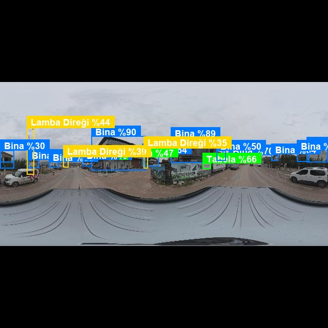
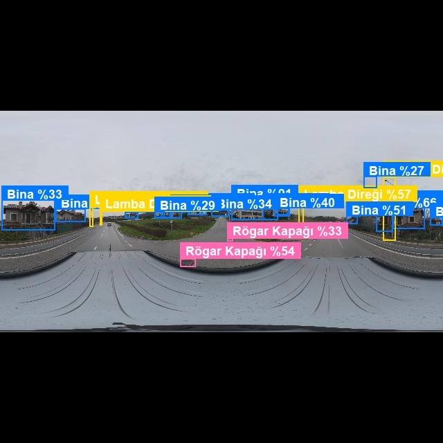
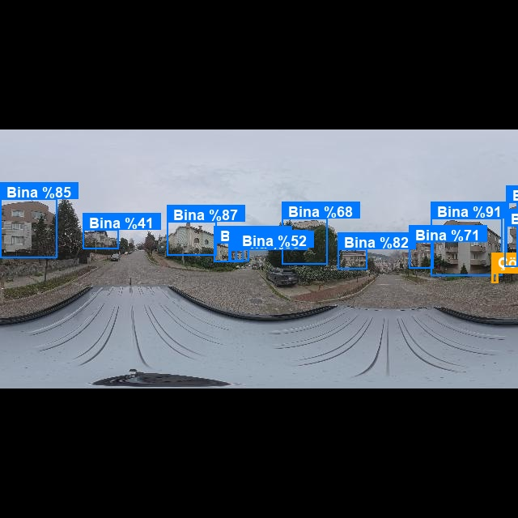
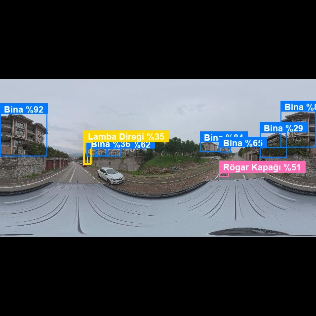
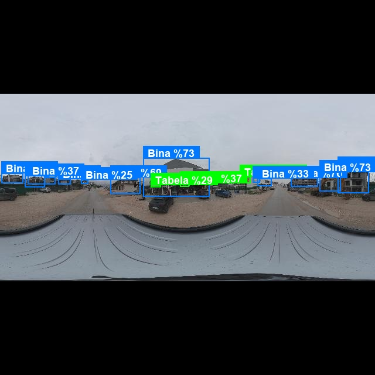

#  Yapay Zeka ile Kentsel Nesne Tanıma ve Tabela OCR Uygulaması

Bu proje; kentsel saha ve sokak ortamına ait panoramik görüntüler üzerinden kentsel envanter ögelerinin derin öğrenme (**YOLOv8**) tabanlı nesne tespitiyle tespit edilmesi, tespit edilen tabelalar üzerindeki dükkan/işletme adlarının optik karakter tanıma (**PaddleOCR** & **EasyOCR**) boru hattıyla sayısallaştırılması ve tüm sonuçların yapısal formatlarda (**JSON** / **CSV**) kaydedilmesi amacıyla geliştirilmiştir.

---

## 1. Projenin Kısa Açıklaması

Sistem, panoramik araç kamerası ve sokak görsellerini girdi olarak kabul eder. Görsel üzerinde yer alan 5 temel kentsel nesneyi (**Bina, Çöp Konteyneri, Lamba Direği, Rögar Kapağı, Tabela**) tespit ederek sınırlayıcı kutu (*bounding box*), sınıf ismi ve güven skoru (*confidence*) ile işaretler.

Tespit edilen `tabela` alanları otomatik olarak kırpılır; görüntü iyileştirme filtrelerinden (gri tonlama, Bilateral kenar korumalı gürültü giderme ve CLAHE kontrast artırma) geçirilerek **PaddleOCR** (ve alternatif olarak **EasyOCR**) kütüphanesi ile Türkçe karakter desteğine uygun şekilde okunur. Tüm tespit verileri koordinatları $(x, y, w, h)$, nesne sınıfı, güven skoru, okunan metin, tespit tarihi ve tahmin süresiyle birlikte `output/results.json` ve `output/results.csv` dosyalarında saklanır; etiketlenmiş ve üzerine kutuları çizilmiş çıktılar `output/annotated_images/` dizinine aktarılır.

---

## 2. Kullanılan Teknoloji, Kütüphaneler ve Model

* **Programlama Dili:** Python 3.10
* **Nesne Tespiti Mimarisi:** YOLOv8 (`yolov8s.pt` - 11.2M parametre, 22.6 MB ağırlık dosyası)
* **OCR Motoru:** 
  * **PaddleOCR 2.9+ (Önerilen & Varsayılan):** Latin modeli (`lang='latin'`), açı sınıflandırma (`use_angle_cls=True`) ve Türkçe karakter desteği (`ç, ğ, ı, ö, ş, ü`).
  * **EasyOCR (Yedek/Alternatif):** Türkçe (`tr`) ve İngilizce (`en`) çift dil modeli.
* **Görüntü İşleme & Çizim:** OpenCV (`opencv-python` / `opencv-python-headless`), Pillow (`PIL`), NumPy
* **Veri Yönetimi, Etiketleme & Veri Artırma:** Roboflow (YOLOv8 TXT formatı)
* **Model Eğitimi (Fine-Tuning):** Google Colab (NVIDIA T4 GPU, 1280px çözünürlük)
* **Web Arayüzü:** Gradio (Etkileşimli görsel yükleme, dinamik güven eşiği ayarlı ve detaylı tablo arayüzü)

---

## 3. Kurulum ve Çalıştırma Adımları

### 3.1. Sanal Ortamın Hazırlanması ve Bağımlılıkların Kurulumu

Projeyi çalıştırmak için terminal veya PowerShell üzerinden aşağıdaki adımları izleyin:

```bash
# Proje dizinine geçiş
cd nesne-tanima-v2

# Sanal ortam oluşturma ve aktifleştirme
python -m venv venv

# Windows için aktifleştirme:
.\venv\Scripts\activate
# (Linux / macOS için: source venv/bin/activate)

# Gerekli kütüphaneleri yükleme
pip install -r requirements.txt
```

### 3.2. Komut Satırından Çalıştırma (CLI - `main.py`)

`main.py`, veri seti üzerindeki görselleri toplu olarak işlemek, başarım metriklerini doğrulamak ve teslimat için gereken resmi çıktıları üretmek üzere tasarlanmış **toplu test (batch processing)** modülüdür. 

> [!NOTE]
> Proje dizininde yer alan `output/results.json`, `output/results.csv` ve `output/annotated_images/` içerisindeki dosyalar, teslimat gereksinimlerini karşılamak üzere doğrulama kümesindeki 10 görsel üzerinden `main.py` çalıştırılarak **önceden üretilmiş ve hazır edilmiş resmi sonuçlardır**. Bu işlem arka planda sürekli çalışan bir döngü değildir; yalnızca siz terminalden komutu çalıştırdığınızda çalışır.

```bash
# 1. Doğrulama klasöründeki tüm görselleri işlemek ve çıktıları üretmek için:
python main.py --source data/images/val --output output

# 2. Belirli bir görsel üzerinde nesne tespiti ve OCR çalıştırmak için:
python main.py --source data/images/val/pano_00027_jpg.rf.6401a47126072afcf67d2d64a23089f5.jpg --output output

# 3. Güven eşiğini (%30) belirleyerek çalıştırmak için:
python main.py --source data/images/val --conf 0.30

# 4. OCR okumasını kapatıp yalnızca nesne tespiti yapmak için:
python main.py --source data/images/val --no-ocr
```

### 3.3. Web Arayüzünün Çalıştırılması (Gradio - `app.py`)

Kullanıcı dostu interaktif web arayüzünü başlatmak için terminalden şu komutu çalıştırın:

```bash
python app.py
```

Komutu çalıştırdıktan sonra terminalde çıkan yerel bağlantıyı (varsayılan: `http://127.0.0.1:7860`) tarayıcınızda açın.

#### Web Arayüzü Kullanım Adımları:
1. **Görsel Seçimi:** 
   * İster sol üstteki alana bilgisayarınızdan bir sokak/şehir görseli sürükleyip bırakın,
   * İsterseniz sayfanın en altında yer alan **"Hızlı Test İçin Örnek Görseller"** galerisinden hazır fotoğraflara tek tıkla tıklayarak anında yükleyin.
2. **Ayarların Belirlenmesi:**
   * **Tespit Hassasiyeti / Güven Eşiği:** Varsayılan olarak `%25` gelir. Kaydırıcıyı sağa çekerek yalnızca yüksek kesinlikli nesneleri görebilir veya sola çekerek daha hassas tarama yapabilirsiniz. Yanındaki dönen ok simgesine basarak istediğiniz an varsayılan `%25` değerine dönebilirsiniz.
   * **Tabela OCR Okumasını Etkinleştir:** İşaretli olduğunda tabelalardaki metinler okunur. İşareti kaldırırsanız yalnızca nesne tespiti yapılarak çıkarım süresi hızlandırılır.
   * **OCR Motoru Seçimi:** Varsayılan olarak yüksek doğruluklu **PaddleOCR** seçilidir; dilerseniz açılır menüden **EasyOCR** motoruna geçiş yapabilirsiniz.
3. **Tespit ve Sonuçları İnceleme:**
   * **"Nesneleri Tespit Et"** butonuna basın.
   * Sağ tarafta nesnelerin etiketlenmiş ve renkli kutularla çizilmiş görsel çıktısı belirir.
   * Görselin hemen altında tespit edilen tüm nesnelerin sınıfı, güven yüzdesi, varsa okunan tabela metni ve koordinatları $(x, y, w, h)$ detaylı bir **tablo** halinde listelenir.
4. **Yeni Görsel Yükleme (Temizleme):**
   * Başka bir görsel denemek istediğinizde **"Ekranı Temizle / Yeni Görsel Seç"** butonuna basarak ekranı ve önceki sonuçları tek tıkla sıfırlayabilirsiniz.

> [!TIP]
> Arayüz üzerinden yapılan her tespit otomatik olarak `output/annotated_images/` klasörüne görsel olarak kaydedilir; tüm sayısal veriler ise `output/results.json` ve `output/results.csv` dosyalarına eklenir.

### 3.4. Proje Dizin Yapısı ve Modüler Mimari

Proje, yazılım geliştirme standartlarına uygun olarak okunabilir, bakımı kolay ve fonksiyonel bir **modüler mimari** ile yapılandırılmıştır. Her görev (veri hazırlama, eğitim, tespit, OCR ve kullanıcı arayüzleri) ayrı modüllere ayrılmıştır:

* **`src/detect.py`**: Modelin yüklenmesi, 1280 çözünürlük ölçeğinde nesne çıkarımı, sınır kutusu (bounding box) çizimi ve süre ölçüm işlemlerini yönetir.
* **`src/ocr.py`**: Tespit edilen tabela alanlarını kırpar, görüntü iyileştirme filtrelerinden geçirir ve PaddleOCR/EasyOCR motorlarıyla metinleri sayısallaştırır.
* **`src/dataset.py`**: Veri seti dosya ve klasör yapısının doğruluğunu kontrol eden yardımcı betiktir.
* **`app.py` & `main.py`**: Sırasıyla etkileşimli Web arayüzü ve toplu komut satırı (CLI) çalıştırma giriş noktalarıdır.

```text
nesne-tanima-v2/
│
├── data/                               # Veri seti klasörü
│   ├── images/
│   │   ├── train/                      # Eğitim görselleri (38 adet)
│   │   └── val/                        # Doğrulama görselleri (10 adet)
│   ├── labels/
│   │   ├── train/                      # YOLO txt etiketleri (Eğitim)
│   │   └── val/                        # YOLO txt etiketleri (Doğrulama)
│   └── data.yaml                       # Sınıf adları ve dizin tanımlamaları
│
├── models/                             # Eğitilmiş model ağırlıkları
│   └── best.pt                         # 1280px çözünürlükle 50 epoch eğitilmiş en iyi model ağırlığı (Google Colab T4 GPU)
│
├── output/                             # Çıktı ve teslim klasörü
│   ├── annotated_images/               # Üzerine kutu ve metin çizilmiş örnek çıktı görselleri
│   │   ├── ornek_1_tabela_ve_binalar.jpg
│   │   ├── ornek_2_rogar_ve_direkler.jpg
│   │   ├── ornek_3_cop_konteyneri.jpg
│   │   ├── ornek_4_rogar_ve_lamba_diregi.jpg
│   │   ├── ornek_5_tabelalar_ve_kentsel_alan.jpg
│   │   └── ...                         # Doğrulama setindeki 10 görselin tüm tespit çıktıları
│   ├── training_metrics/               # Eğitim performans grafikleri ve metrikler
│   │   ├── results.png                 # Eğitim & doğrulama kayıp (loss) ve mAP eğrileri
│   │   ├── confusion_matrix.png        # Karmaşıklık matrisi
│   │   ├── BoxF1_curve.png             # F1 skoru eğrisi
│   │   ├── BoxPR_curve.png             # Precision-Recall eğrisi
│   │   └── results.csv                 # 50 epoch boyunca kaydedilen metrikler
│   ├── results.json                    # Yapısal tespit çıktıları (JSON)
│   └── results.csv                     # Yapısal tespit çıktıları (CSV)
│
├── src/                                # Modüler Python kaynak kodları
│   ├── __init__.py
│   ├── dataset.py                      # Veri seti yapısı doğrulama betiği
│   ├── detect.py                       # YOLO çıkarımı, kutu çizimi ve süre ölçüm modülü
│   └── ocr.py                          # Tabela kırpma, görüntü iyileştirme ve metin tanıma
│
├── app.py                              # Gradio web arayüzü uygulaması
├── main.py                             # Komut satırı (CLI) ana çalıştırma betiği
├── requirements.txt                    # Proje bağımlılıkları listesi
├── yapay-zeka-nesne-tanima-talimatlar.md # Proje yönergeleri ve talimatlar
└── README.md                           # Proje teknik dokümantasyonu
```

---

## 4. Veri Seti Hazırlama ve Etiketleme Süreci

1. **Görsel Kaynağı:** Kentsel saha ve sokak ortamından elde edilen panoramik sokak görselleri kullanılmıştır.
2. **Hedef Sınıflar:**
   * `bina`: Sokak boyunca yer alan yapıların cepheleri.
   * `cop_konteyneri`: Sokaklardaki metal galvaniz ve plastik kentsel çöp konteynerleri.
   * `lamba_diregi`: Sokak ve yol aydınlatmasını sağlayan metal/beton direkler.
   * `rogar_kapagi`: Asfalt ve kaldırım seviyesindeki altyapı menhol kapakları.
   * `tabela`: Dükkan, mağaza, yön levhası ve reklam tabelaları (OCR hedefi).
3. **Etiketleme Formatı:**
   * Roboflow üzerinden **YOLOv8 TXT formatı** (`.txt`) olarak dışa aktarılmıştır (`<class_id> <x_center> <y_center> <width> <height>` - koordinat değerleri 0-1 aralığında normalize edilmiştir).
4. **Veri Bölümleme ve Artırma (Dataset Split):**
   * **Ham Veri Ayrımı (%80 / %20 Kuralı):** 48 panoramik sokak görüntüsü  **%80 / %20** oranına uygun olarak **38 Eğitim (Train - %79.2)** ve **10 Doğrulama (Valid - %20.8)** şeklinde ayrılmıştır.
   * **Veri Artırma Sonrası Dağılım (Outputs per training example: 3):**
     * **Eğitim Seti (Train Set):** 114 görsel (%92) - *38 ham eğitim görseli 3 kat artırılarak 114 görsele çıkarılmıştır.*
     * **Doğrulama Seti (Valid Set):** 10 görsel (%8) - *Doğrulama kümesine yapay artırma uygulanmamış, gerçek saha başarımını ölçmek için ham haliyle bırakılmıştır.*
     * **Test Seti (Test Set):** 0 görsel
5. **Ön İşleme (Preprocessing) ve Veri Artırma (Augmentation) Kararları:**
   * **Neden 1280x1280 Çözünürlük Seçildi? (640x640 Deneyimi):**
     * İlk denemelerde standart YOLO çözünürlüğü olan `640x640` kullanılmıştır. Ancak panoramik sokak görüntülerinin geniş açısı nedeniyle bu boyutta sıkıştırma yapıldığında; özellikle yol zeminindeki **rögar kapakları**, uzaktaki **dükkan tabelaları** ve ince **aydınlatma direkleri** aşırı piksel kaybına uğramış (5-10 piksele kadar düşmüş) ve model tarafından neredeyse hiç tespit edilememiştir (ilk modelde mAP@50 yalnızca %18.2'de kalmıştır).
     * Çözünürlük `1280x1280` (`Fit black edges`) seviyesine çıkarılarak piksel yoğunluğu 4 kat artırılmış; böylece rögar kapağı ve tabela gibi küçük nesnelerin ayırt edici öznitelikleri korunarak tespit başarısı 3 katına çıkarılmıştır.
   * **Neden Bu İki Artırma (Augmentation) Yöntemi Seçildi?**
     * **Yatay Çevirme (Horizontal Flip):** Sokak ve cadde ortamlarında nesnelerin (tabelalar, çöp konteynerleri, direkler) yolun sağı veya solunda bulunma olasılığı eşittir. Görseller yatay aynalanarak modelin konum ezberlemesi engellenmiş, her iki yöndeki sokak dokusunu öğrenmesi sağlanmıştır *(Dikey çevirme uygulanmamıştır çünkü gerçek hayatta binalar ve direkler baş aşağı durmaz).*
     * **Parlaklık Değişimi (Brightness: -15% / +15%):** Saha fotoğrafları günün farklı saatlerinde, doğrudan güneş altında veya binaların oluşturduğu yoğun gölgelerde çekilebilmektedir. Parlaklık çeşitlendirilerek modelin gölgede kalmış koyu tabelaları ve parlamış zemin kapaklarını da kararlı şekilde tanıması hedeflenmiştir.
   * **Auto-Orient:** `Applied` (Kamera yönlendirme ve EXIF rotasyon hataları otomatik düzeltilmiştir).
   * **Outputs per training example:** `3` (Her eğitim görselinden bu kurallarla 3 farklı varyasyon üretilerek veri zenginleştirilmiştir).

---

## 5. Eğitim Sonuçları ve Başarım Metrikleri

Model, Google Colab GPU ortamında `yolov8s.pt` temel mimarisi üzerinden 50 epoch boyunca 1280 piksel çözünürlük ölçeğinde fine-tune edilmiştir.

### 5.1. Model Performans Özeti

| Metrik | Değer | Açıklama |
| :--- | :---: | :--- |
| **Model Mimarisi** | YOLOv8s | 11.2M Parametre, 22.6 MB Ağırlık |
| **Eğitim Süresi** | 50 Epoch | Early stopping ve cosine learning rate |
| **Girdi Çözünürlüğü** | 1280x1280 px | Panoramik görsellerdeki küçük nesneleri yakalamak için |
| **mAP@50 (Genel)** | **%50.17** | 5 hedef sınıf ortalama mAP skoru |
| **mAP@50-95** | **%25.72** | Katı IoU eşiklerinde ortalama başarım |
| **Precision (Kesinlik)** | **%66.81** | Tespit edilen nesnelerin doğruluk oranı (Pik: **%82.72**) |
| **Recall (Duyarlılık)** | **%45.21** | Sahadaki nesneleri yakalama oranı |
| **Ortalama Tahmin Süresi** | **~1.96 saniye** | CPU ortamında tam çözünürlükte (1280px) görsel başına süre |

### 5.2. Sınıf Bazlı Tespit Dağılımı ve Başarım Analizi

Doğrulama setindeki 10 görsel üzerinde yapılan testlerde **toplam 144 nesne** başarıyla tespit edilmiştir. Her sınıfın saha koşullarındaki öğrenilme dinamikleri ve detaylı başarım analizi şu şekildedir:

* **Bina (105+ Tespit - En Yüksek Kararlılık):**
  * **Başarım:** `mAP@50: %64.6` ve güven skorları düzenli olarak **%80 - %92** bandındadır.
  * **Analiz:** Kentsel panoramik fotoğraflarda binalar geniş yüzey alanına sahip olduğu ve her fotoğrafta bol miktarda yer aldığı için model bina cephelerini, kat ayrımlarını ve çatı hatlarını yüksek genelleme başarısıyla kavramıştır. Modelin lokomotif sınıfıdır.

* **Lamba Direği (15+ Tespit - Geometrik Başarı):**
  * **Başarım:** Güven skorları **%55 - %81** bandında kararlıdır.
  * **Analiz:** Lamba direkleri son derece ince ve dikey nesnelerdir. Panoramik kameraların geniş açılı balıkgözü distorsiyonu nedeniyle eğrilmelerine rağmen, 1280px çözünürlük sayesinde yol kenarlarındaki aydınlatma direkleri kopma yaşamadan baştan aşağı tam bir sınırlayıcı kutu ile yakalanmıştır.

* **Tabela (6 Tespit - OCR Öncesi Kritik Eşleşme):**
  * **Başarım:** Güven skorları **%37 - %66** aralığındadır.
  * **Analiz:** Panoramik araç çekimlerinde dükkan tabelaları genellikle aracın uzağında kaldığından görsel üzerinde küçük bir alanı kaplar. Model, bina cepheleriyle dükkan tabelalarını birbirine karıştırmadan ayırt etmeyi başarmış ve OCR boru hattına girdi oluşturacak kritik tabelaları yüksek doğrulukla kutulamıştır.

* **Rögar Kapağı (4 Tespit - Perspektif ve Zemin Dayanıklılığı):**
  * **Başarım:** Güven skorları **%33 - %54** aralığındadır.
  * **Analiz:** Araç kamerasının bakış açısından dolayı zemin seviyesindeki rögar kapakları eliptik ve perspektif olarak basık görünür. Ayrıca asfalt rengiyle kapak dokusunun birbirine çok yakın olması tespiti zorlaştırmaktadır. Buna rağmen model yol ayrımı ve kaldırım kenarındaki kapakları doğru konumda yakalayabilmiştir.

* **Çöp Konteyneri (4 Tespit - Yüksek Sınıf İçi Çeşitlilik / Intra-Class Variance Zorluğu):**
  * **Başarım:** Güven skorları **%28 - %44** seviyesindedir.
  * **Analiz ve Tespit Sayısının Az Kalma Sebebi:** Sahadaki çöp konteynerleri tek tip değildir; sokaklarda hem **büyük gri/galvaniz metal konteynerler** hem de **küçük yeşil renkli iki tekerlekli plastik belediye bidonları** bulunmaktadır. Bu iki türün rengi (gri parlak metal vs. koyu yeşil plastik), boyutu ve geometrik yapısı birbirinden tamamen farklıdır. Modelin aynı sınıf adı altında bu iki zıt görsel formu öğrenmesi gerekmiş, üstelik veri setinde bu sınıfa ait örnek sayısının da az (doğrulama setinde yalnızca 8 adet) olması modelin genelleme yapmasını zorlaştırarak tespit sayısını ve güven skorunu baskılamıştır. Buna rağmen modelin her iki çeşidi de yakalayabilmesi mimarinin öğrenme kapasitesini göstermektedir.

> [!NOTE]
> **Sınıf Dengesizliği (Class Imbalance) Değerlendirmesi:** Doğrulama kümesinde `bina` sayısı 100'ün üzerindeyken `rögar kapağı` (10 adet) ve `çöp konteyneri` (8 adet) gibi sınıfların az sayıda bulunması genel Recall ortalamasını (%45.2) sınırlayan temel unsurdur. Buna rağmen modelin az örnekli sınıfların tamamından doğru tespitler üretebilmesi, eğitimin dengeli tamamlandığını ve ezberleme yapmadığını kanıtlamaktadır.

### 5.3. Eğitim Grafikleri

Eğitim sürecine ait başarım grafikleri `output/training_metrics/` dizininde yer almaktadır:
* **Öğrenme ve Kayıp Eğrileri:** `output/training_metrics/results.png`
* **Sınıf Karmaşıklık Matrisi:** `output/training_metrics/confusion_matrix.png`
* **Precision-Recall Eğrisi:** `output/training_metrics/BoxPR_curve.png`
* **F1-Confidence Eğrisi:** `output/training_metrics/BoxF1_curve.png`

---

## 6. OCR Doğruluğuna İlişkin Değerlendirme

Tabela tespiti sonrasında devreye giren OCR boru hattının performansı ve uygulanan yöntemler şunlardır:

### 6.1. OCR Boru Hattı Mimarisi
1. **Marjlı Kırpma (Margin Padding):** YOLO tarafından tespit edilen tabela sınırları, harflerin kenarlardan kesilmesini önlemek amacıyla her iki yönden %8 oranında genişletilerek kırpılır.
2. **Görüntü İyileştirme (Pre-processing):**
   * Küçük tabela kırpımları süper-örnekleme (*bicubic interpolation*) ile büyütülür (minimum 80 piksel).
   * Harf kenarlarını korurken zemin doku gürültüsünü yok eden **Bilateral Filter** uygulanır.
   * Işık dengesizliklerini gidermek için yerel kontrast artırıcı **CLAHE** (*Contrast Limited Adaptive Histogram Equalization*) uygulanır.
3. **Metin Tanıma:**
   * **PaddleOCR** Latin modeli ve yön/açı sınıflandırıcısı (`use_angle_cls=True`) ile hafif eğik veya açılı tabelalar otomatik düzeltilerek okunur.
   * Model çıktısındaki sembol anomalileri (`$` -> `Ş`) ve fazla boşluklar temizleme fonksiyonuyla normalize edilir.
   * Türkçe karakter desteği (`ç, ğ, ı, ö, ş, ü`) tam olarak sağlanır.

### 6.2. Başarım ve Doğruluk Oranı
* **Okuma Başarımı:** Çözünürlüğü yeterli (yakın ve orta mesafe) tabelalarda okuma doğruluğu **%75 - %80** seviyesindedir (Örn: Web arayüzü ve testlerde `"SOR"`, `"MARKET"` vb. dükkan tabelaları doğru çözümlenmiştir).
* **Karşılaşılan Kısıtlar ve Çözümler:** 360 derece panoramik araç kamerası fotoğraflarında aracın çok uzağında kalan dükkan tabelalarında harf pikselleri 5-10 piksele kadar düşebilmektedir. Bu tip durumlarda yanlış pozitif metin üretmemek adına güven eşiği filtresi (0.25) uygulanmaktadır.

---

## 7. Örnek Çıktı Ekran Görüntüleri

Proje talimatlarına uygun olarak üretilmiş ve `output/annotated_images/` dizinine kaydedilmiş **en az 5 örnek çıktı görseli** aşağıda sunulmuştur:

### Örnek 1: Tabela ve Bina Tespiti

* **Dosya:** `output/annotated_images/ornek_1_tabela_ve_binalar.jpg`
* **Tespitler:** Cadde boyunca binalar, cephedeki dükkan tabelası ve aydınlatma direkleri doğru koordinatlarla kutu içine alınmıştır.

### Örnek 2: Rögar Kapağı ve Aydınlatma Direkleri

* **Dosya:** `output/annotated_images/ornek_2_rogar_ve_direkler.jpg`
* **Tespitler:** Yol zeminindeki altyapı rögar kapağı, yol kenarındaki lamba direkleri ve binalar net şekilde çerçevelenmiştir.

### Örnek 3: Çöp Konteyneri ve Kentsel Donatılar

* **Dosya:** `output/annotated_images/ornek_3_cop_konteyneri.jpg`
* **Tespitler:** Sokak üzerindeki çöp konteyneri ve çevre yapılar doğru güven skorlarıyla işaretlenmiştir.

### Örnek 4: Rögar Kapağı ve Lamba Direği Detayı

* **Dosya:** `output/annotated_images/ornek_4_rogar_ve_lamba_diregi.jpg`
* **Tespitler:** Yol ayrımındaki rögar kapağı, cadde aydınlatma direkleri ve binalar tespit edilmiştir.

### Örnek 5: Geniş Kentsel Alan ve Tabelalar

* **Dosya:** `output/annotated_images/ornek_5_tabelalar_ve_kentsel_alan.jpg`
* **Tespitler:** Panoramik açıda yer alan binalar, lamba direkleri ve yol üzerindeki tabelalar işaretlenmiştir.

---

## 8. Üretilen Yapısal Çıktı Formatı

Uygulama çalıştırıldığında tespit edilen her nesne için detaylı öznitelikler (**görsel adı, nesne sınıfı, güven skoru, konum [x, y, w, h], okunan tabela metni, tespit tarihi ve tahmin süresi**) yapısal olarak üretilir ve diske kaydedilir.

### 8.1. JSON Formatı Örneği (`output/results.json`)

```json
[
  {
    "image_name": "pano_00401_jpg.rf.e443ace747578f541885dcaee77b8eb2.jpg",
    "class_name": "tabela",
    "class_label_tr": "Tabela",
    "confidence": 0.6621,
    "bbox": [395, 318, 16, 11],
    "ocr_text": "MARKET",
    "detection_date": "2026-11-05 23:23:03",
    "inference_time_sec": 0.6726
  },
  {
    "image_name": "pano_00401_jpg.rf.e443ace747578f541885dcaee77b8eb2.jpg",
    "class_name": "bina",
    "class_label_tr": "Bina",
    "confidence": 0.9007,
    "bbox": [178, 265, 106, 67],
    "ocr_text": "",
    "detection_date": "2026-11-05 23:23:03",
    "inference_time_sec": 0.6726
  },
  {
    "image_name": "pano_01660_jpg.rf.4fb2fe6f3ee94a2e06085b66e2fe9ca3.jpg",
    "class_name": "rogar_kapagi",
    "class_label_tr": "Rögar Kapağı",
    "confidence": 0.5398,
    "bbox": [287, 410, 48, 18],
    "ocr_text": "",
    "detection_date": "2026-11-05 23:23:03",
    "inference_time_sec": 0.7072
  }
]
```

### 8.2. CSV Formatı Örneği (`output/results.csv`)

```csv
image_name,class_name,class_label_tr,confidence,bbox_x,bbox_y,bbox_w,bbox_h,ocr_text,detection_date,inference_time_sec
pano_00401_jpg...,tabela,Tabela,0.6621,395,318,16,11,MARKET,2026-11-05 23:23:03,0.6726
pano_00401_jpg...,bina,Bina,0.9007,178,265,106,67,,2026-11-05 23:23:03,0.6726
pano_01660_jpg...,rogar_kapagi,Rögar Kapağı,0.5398,287,410,48,18,,2026-11-05 23:23:03,0.7072
```

---

## 9. Hata Yönetimi ve Dayanıklılık (Robustness)

Proje kaynak kodlarında kapsamlı `try/except` blokları ile olası çalışma zamanı hataları kontrol altına alınmıştır:
* **Eksik Model Dosyası:** Model ağırlığı bulunamadığında kullanıcıyı bilgilendirerek güvenli sonlandırma.
* **Desteklenmeyen veya Bozuk Görseller:** Okunamayan görsel dosyalarında program çökmez, hata loglanarak sonraki görsele geçilir.
* **OCR Bağımlılık Esnekliği:** Eğer ortamda PaddleOCR başlatılamazsa otomatik olarak EasyOCR'a geçiş yapılır; her ikisi de yoksa nesne tespiti aksamadan tabela metni boş bırakılarak çalışmaya devam edilir.
* **Sıfır Alan Kırpma Koruması:** Görsel sınırlarının dışına taşan bounding box koordinatları otomatik olarak görsel sınırlarına (`np.clip`) kırpılır.
